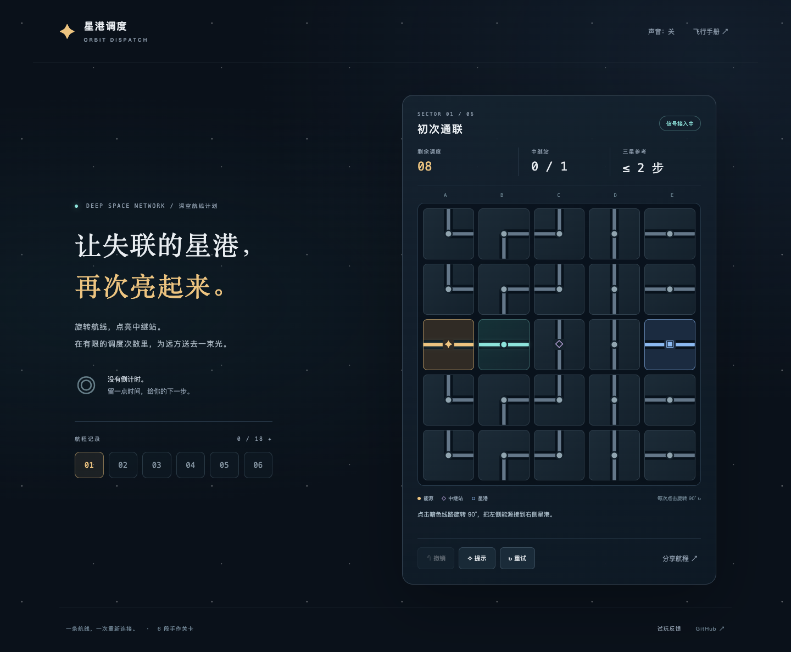

# 星港调度 · Orbit Dispatch

旋转航线，点亮中继站，在有限的调度次数里，把能源送到远方的星港。

**[打开游戏](https://yiheng-guo.github.io/orbit-dispatch/)** · [玩法与产品定义](docs/PRODUCT.md) · [技术设计](docs/ARCHITECTURE.md) · [试玩指南](docs/PLAYTEST.md)



六段手作关卡，从直线通联到多次折返。支持鼠标、键盘和触屏，没有倒计时；可以撤销、获取提示、重试与选择关卡。星级和试玩记录保存在本机，反馈可导出，不会自动上传。

## 怎么玩

1. 点击线路，顺时针旋转 90°。相邻开口对齐后，能源会沿线路传播。
2. 连接金色能源、蓝色星港和所有菱形中继站，不必点亮所有线路。
3. 每次旋转消耗一次调度。次数用尽时，可以撤销或重试。使用提示后，本次最多获得一星。

键盘：方向键选格，Enter / 空格旋转，U 撤销、H 提示、R 重试。关卡链接可单独分享。

## 本地运行

无第三方运行时依赖。需要 Python 3 启动静态服务，Node.js 22+ 运行规则测试。

```bash
git clone https://github.com/Yiheng-guo/orbit-dispatch.git
cd orbit-dispatch
npm test
npm start
```

打开终端显示的本地地址，默认端口 4173。ES modules 需要 HTTP 服务，避免直接双击 HTML。

## 开发方法

使用 [PM Game Skills](https://github.com/Yiheng-guo/pm-game-skills) 的产品定义、引擎决策、代码质量、解谜、界面和试玩发布方法。规则、关卡、展示与存储分别维护；所有关卡包含可通过公开规则操作验证的预设解法。有关技能来源见 [开发流程](docs/WORKFLOW.md)。

自动检查能够验证规则与操作链路，不能证明真人觉得好玩。真人试玩需要按指南记录实际反馈。

## 浏览器验证

```bash
npm ci
npx playwright install chromium
# 先在另一个终端运行 npm start
npm run test:browser
```

已安装 Chrome 时，可通过 `CHROME_PATH` 指定浏览器可执行文件；`GAME_URL` 指定本地或公开测试地址。浏览器测试会创建和覆盖测试浏览器内的游戏记录，不访问日常浏览器资料。

## 发布

GitHub Pages 使用 main 分支根目录；所有资源采用相对路径，支持仓库子路径。回退时选择一个已确认可用的历史提交。没有后台、账号、付费 API 或远程统计服务。

## 许可证

[MIT](LICENSE)。界面、SVG 图形、关卡和短音效由本项目代码构成，无外部图片、字体或音频下载依赖。技能包的 Apache 2.0 许可证与本游戏独立。
